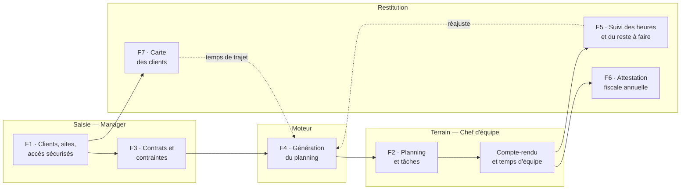
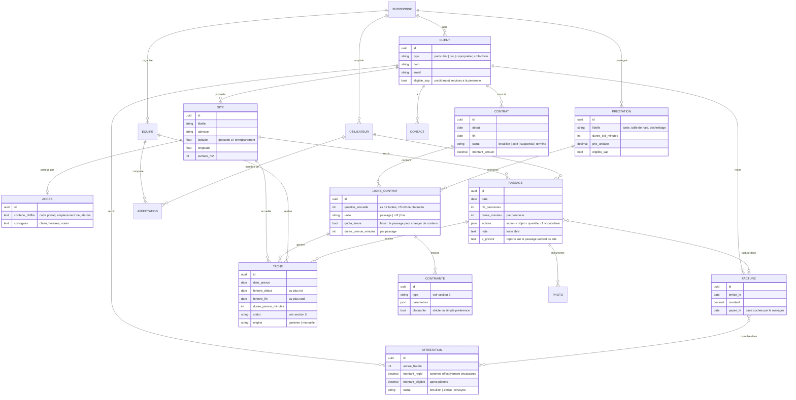
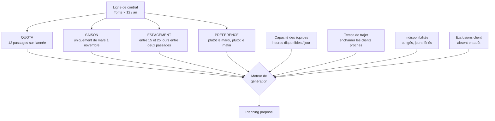
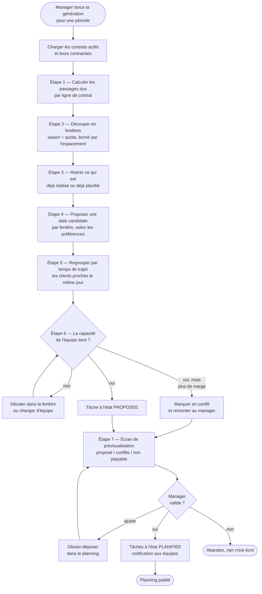
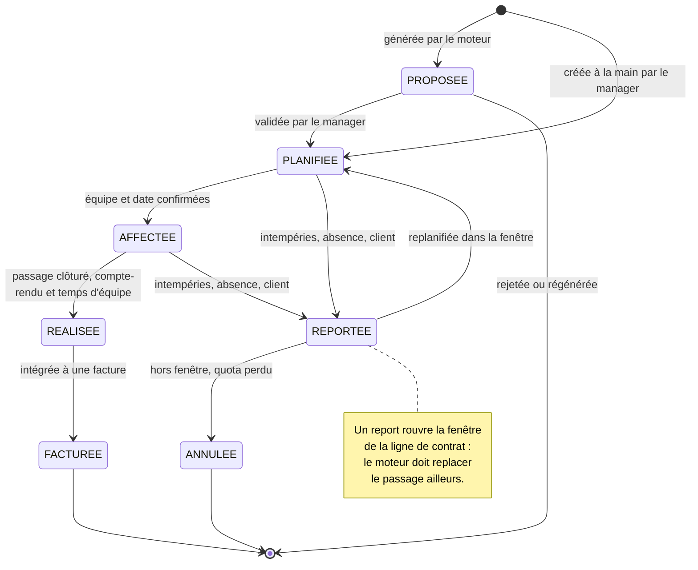
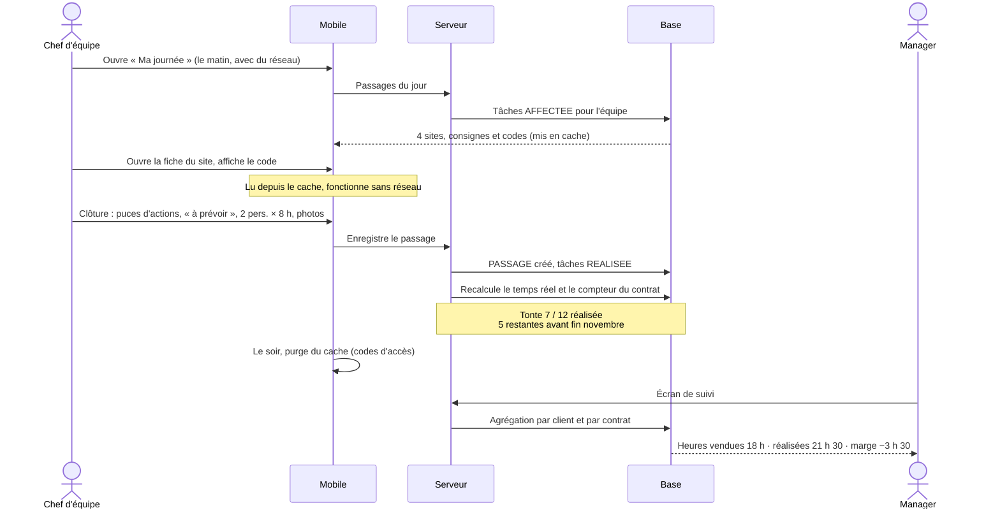
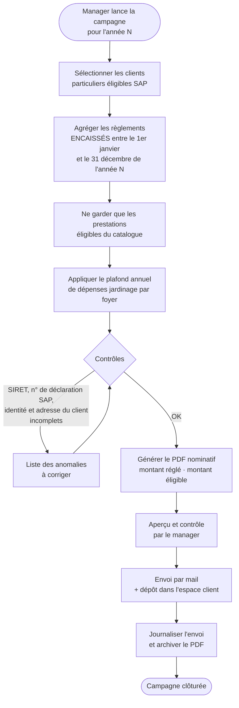
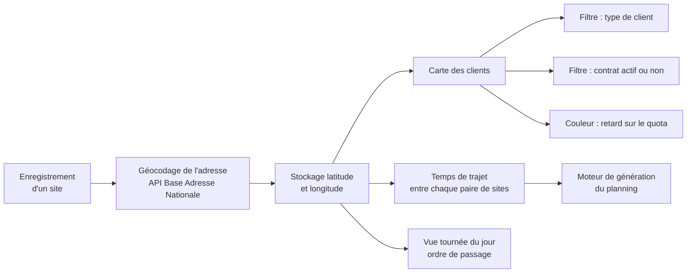
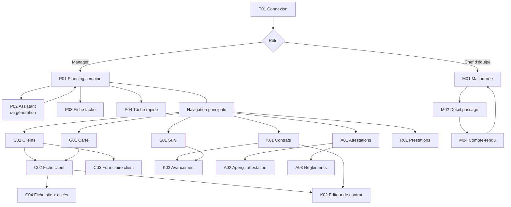

# Planisage — Conception du POC

**Périmètre retenu (6 fonctionnalités + carto)**

| # | Fonctionnalité |
|---|---|
| F1 | Saisie des informations clients, y compris les informations sensibles (codes d'accès, clés, consignes) |
| F2 | Ajout de tâches dans le planning |
| F3 | Contraintes sur les tâches (ex. contrat de 12 tontes par an) |
| F4 | Génération d'un planning à partir des contraintes de chaque client |
| F5 | Suivi des tâches : heures réalisées chez un client, reste à faire |
| F6 | Envoi du bordereau de déduction fiscale au client |
| F7 | Cartographie : répartition des clients sur une carte |

**Contexte, d'après les [réponses au cadrage](04-reponses-cadrage.md) du 20/09/2026**

- **Un seul utilisateur au départ, Eliot**, à la fois manager et chef d'équipe, en conditions réelles **à partir de janvier 2027**.
- **Critères de réussite** : la génération des plannings, les heures par semaine sur chantier et le compte-rendu client.
- **L'outil actuel est papier** : fiche client + cahier de comptes rendus ([transcription](03-fiches-papier-eliot.md)). Planisage doit d'abord le remplacer.

| Décision | Effet sur ce document |
|---|---|
| Quota **ferme ou indicatif selon le client**. En indicatif, un passage peut changer de contenu (pas de tonte si l'herbe ne pousse pas → désherbage, petite taille) | §3 : option `ferme` sur la ligne de contrat ; on compte des **passages**, pas des tâches figées |
| Le **chef d'équipe** saisit le temps de toute l'équipe, sans géolocalisation, et ce n'est pas la base de la paie | §2 : `POINTAGE` remplacé par un temps d'équipe sur le `PASSAGE` ; pas de validation hebdomadaire |
| Codes d'accès visibles par les **chefs d'équipe seulement**, **sans journal** des consultations | §2 : plus d'horodatage des consultations ; C05 abandonné |
| Regroupement **par temps de trajet**, sans zones | §4 et §8 : plus de champ `secteur` ; le moteur utilise les temps de trajet entre sites |
| Déclaré **SAP** | F6 testable en conditions réelles |
| Paiement suivi par la case « payée le… » sur la facture | §2 : `REGLEMENT` remplacé par `FACTURE.payee_le` |
| Réseau presque toujours disponible ; hors ligne en lecture seule accepté (planning du jour, adresse, consignes, code) | Cache de la journée sur le téléphone, purgé chaque soir |
| **Multi-tenant dès le POC** : Planisage sera vendu à d'autres paysagistes, Eliot est la première entreprise (décision du 10/11/2026) | §2 : `entreprise_id` sur les tables, isolation par la base (PostgreSQL Row-Level Security) |

---

## 1. Vue d'ensemble

Le point important : **F4 alimente F2, et F5 réalimente F4.** Si un passage saute
(intempéries, absence), le moteur doit replanifier le reste de l'année pour tenir le
quota du contrat. C'est ce qui fait la valeur du produit, et c'est la partie la plus
délicate à construire.

---

## 2. Modèle de données

### Points d'attention sur le modèle

**Multi-tenant : une seule base partagée, cloisonnée par `ENTREPRISE`.** Planisage
sera vendu à d'autres paysagistes ; Eliot est la première entreprise.

- Chaque table porte `entreprise_id`, y compris les tables filles (`SITE`, `ACCES`,
  `PASSAGE`…). C'est redondant, mais une règle d'accès par table reste simple.
- L'isolation est faite **par PostgreSQL (Row-Level Security)**, pas par les
  requêtes de l'application. Chaque connexion transmet l'`entreprise_id` de
  l'utilisateur. Une requête qui oublie le filtre ne renvoie rien au lieu de
  renvoyer les données d'un autre paysagiste. C'est essentiel pour `ACCES`.
- Ce qui est propre à chaque paysagiste se range dans `ENTREPRISE`, jamais en dur
  dans le code : SIRET, n° SAP, logo, dépôt de départ des trajets.
- Écarté : une base ou une instance par client, intenable à des dizaines de petits
  clients ; ajouter `entreprise_id` après coup, une migration de toutes les requêtes
  et des données réelles d'Eliot.
- Hors POC : inscription en libre-service, abonnement, administration des clients.
- Un test automatique vérifie qu'une entreprise ne lit aucune donnée d'une autre.

**`ACCES` est une table à part, et c'est volontaire.** Un code de portail ou
l'emplacement d'une clé n'est pas un champ de commentaire comme un autre :

- contenu chiffré en base, jamais en clair dans les journaux ni dans les exports ;
- visible par les **chefs d'équipe seulement**, masqué derrière un bouton
  « afficher ». Pas de journal des consultations (choix d'Eliot) ;
- copié dans le cache hors ligne du téléphone pour la journée, puis **purgé le soir** ;
- purge ou rotation quand le client part.

**`PASSAGE` est l'unité du terrain, `TACHE` celle du planning.** Une ligne du cahier
papier correspond à un passage : une date, une équipe, un temps, plusieurs actions
(tonte, désherbage, souffleur…), un « à prévoir ». Le passage réalise une ou plusieurs
tâches planifiées. En quota indicatif, il compte dans le quota même si son contenu a
changé : une tonte prévue peut devenir du désherbage.

**Le temps est saisi pour l'équipe** (`nb_personnes × duree_minutes`), une fois, à la
clôture. On ne pointe pas de début et de fin par personne. Ce temps alimente tout le §6
(suivi) et révèle si un contrat est rentable.

**`TACHE` porte une fenêtre, pas seulement une date.** `fenetre_debut` /
`fenetre_fin` sont ce qui permet au moteur de décaler un passage sans casser le
contrat. Une tâche qui n'a qu'une date est impossible à replanifier proprement.

**Une facture est payée en une fois** (`payee_le`). shortcut : les paiements partiels
ne sont pas gérés ; à revoir si Eliot en a.

---

## 3. F3 — Les contraintes

C'est le cœur du sujet et la partie que le questionnaire doit préciser. Un « contrat de
12 tontes par an » n'est pas une contrainte, c'est **quatre** contraintes qui se
combinent :

### Catalogue des types de contrainte à implémenter

| Type | Paramètres | Exemple | POC |
|---|---|---|:--:|
| `QUOTA` | nombre, période, ferme | 12 tontes par an ; taille de haie 2 fois par an | ✅ |
| `SAISON` | date début, date fin | tonte de mars à novembre ; haie au printemps et à l'automne | ✅ |
| `ESPACEMENT` | min jours, max jours | 15 à 25 jours entre deux tontes | ✅ |
| `JOUR_PREFERE` | jours de la semaine | mardi ou jeudi | ✅ |
| `EXCLUSION` | plages de dates | client absent du 1er au 20 août | ✅ |
| `DUREE` | minutes | 1 h 30 par passage sur ce site | ✅ |
| `CRENEAU` | heure début, heure fin | uniquement le matin | ⬜ V1 |
| `EQUIPE_IMPOSEE` | équipe | toujours l'équipe de Marc, le client la connaît | ⬜ V1 |
| `METEO` | seuil | pas de tonte si pluie la veille | ⬜ V1 |
| `PRE_REQUIS` | tâche | tailler avant de désherber | ⬜ +tard |

**Réponse d'Eliot : ferme ou indicatif, ça dépend du client.** Le moteur doit donc
gérer les deux :

- **ferme** : les passages sont dus et se planifient un an à l'avance ;
- **indicatif** : le moteur planifie un rythme de passages, et le contenu de chacun se
  décide sur place. Si l'herbe ne pousse pas, le passage sert au désherbage ou à la
  petite taille et compte quand même. Le reste à faire se mesure alors en passages ou
  en heures, pas en tontes.

La taille des arbustes « selon la floraison » relève de `SAISON`, avec une période par
végétal. Pour le POC, Eliot la saisit à la main sur la ligne de contrat ; un catalogue
de végétaux viendra plus tard.

---

## 4. F4 — Génération du planning

### Trois règles de conception à tenir

1. **Le moteur propose, l'humain valide.** Rien n'est écrit dans le planning réel
   avant la validation du manager. Un moteur qui écrit tout seul est rejeté par les
   utilisateurs dès le premier passage aberrant.
2. **Une génération est rejouable et ne détruit rien.** On régénère uniquement ce qui
   est encore à l'état `PROPOSEE` ; ce qui est validé, déplacé à la main ou déjà
   réalisé est intouchable. Sans cette règle, le manager perd son travail à chaque
   relance et n'utilise plus la fonction.
3. **L'échec est une réponse acceptable.** Si un passage ne rentre nulle part, on
   l'affiche comme « non plaçable » avec la raison. Un moteur qui force une solution
   incohérente est pire qu'un moteur qui dit non.

Pour le POC, un algorithme glouton (étaler les fenêtres, remplir au plus tôt dans la
capacité restante, enchaîner les sites au plus court temps de trajet) suffit largement. L'optimisation fine des
tournées est un chantier en soi, à garder pour plus tard.

---

## 5. Cycle de vie d'une tâche

---

## 6. F5 — Suivi des tâches et du reste à faire

**Les deux indicateurs qui portent la fonctionnalité :**

| Indicateur | Calcul | À quoi ça sert |
|---|---|---|
| **Reste à faire** | quota du contrat − tâches `REALISEE`, rapporté aux jours restants dans la saison | « Il me reste 5 tontes à caser avant fin octobre chez les Martin » |
| **Dérive horaire** | temps d'équipe des passages − durée prévue, par contrat | « Ce contrat me coûte 3 h 30 de plus que ce que je l'ai vendu » |

C'est le deuxième qui fera vendre le produit : aucun paysagiste ne sait aujourd'hui
quel contrat d'entretien lui fait perdre de l'argent.

---

## 7. F6 — Bordereau de déduction fiscale

Il s'agit de l'**attestation fiscale annuelle services à la personne** : le client
particulier bénéficie d'un crédit d'impôt de 50 % sur les petits travaux de jardinage,
et il lui faut un justificatif nominatif pour sa déclaration.

### Trois points qui vont mordre

1. **L'attestation se base sur les sommes encaissées, pas facturées.** Une facture de
   décembre payée en janvier bascule sur l'année fiscale suivante. **Décidé :** Eliot
   coche « payée le… » sur la facture dans l'application. Reste à savoir si
   Planisage émet ces factures ou si elles ne font qu'y être enregistrées (§11).
2. **L'entreprise doit être déclarée SAP** auprès de l'État pour que l'attestation ait
   une valeur. **Eliot l'est**, la fonctionnalité est donc testable chez lui.
3. **Seules certaines prestations sont éligibles** (petit jardinage chez un
   particulier, avec un plafond de dépenses annuel), et l'abattage ou la création d'un
   jardin ne le sont pas. D'où le drapeau `eligible_sap` au niveau de la prestation et
   non du client. Les montants de plafond et les règles exactes sont à vérifier auprès
   de son comptable avant l'implémentation — ils changent régulièrement et je ne veux
   pas les figer dans le code sur la base d'un chiffre approximatif.

---

## 8. F7 — Cartographie

La carte a deux usages, et c'est le second qui compte vraiment :

- **Visualiser** la répartition des clients — utile commercialement, agréable en démo ;
- **Alimenter le moteur** : Eliot raisonne en temps de trajet, pas en zones. Les
  coordonnées servent à calculer le temps de trajet entre deux sites, ce qui permet
  d'enchaîner les passages proches le même jour. C'est ce qui évite un planning
  théoriquement valide mais qui fait traverser le département trois fois dans la
  journée. Il cite deux secteurs habituels, Meursault et Fontaine-lès-Dijon, que le
  moteur doit éviter de mélanger dans une même journée.

Le temps de trajet se calcule une fois par paire de sites, à l'enregistrement, avec un
routeur sur données OpenStreetMap (OSRM ou OpenRouteService). Avec quelques dizaines
de clients, cela reste une petite table.

Le géocodage se fait une fois, à l'enregistrement du site. Base Adresse Nationale est
gratuite et sans clé pour les adresses françaises ; le fond de carte peut venir
d'OpenStreetMap ou de l'IGN, ce qui évite la facturation à l'usage d'une carte
propriétaire.

---

## 9. Écrans à créer

### Synthèse

| | POC | V1 complète |
|---|:---:|:---:|
| Web — manager | **18** | 27 |
| Mobile — chef d'équipe | **3** | 5 |
| Transverse | **1** | 2 |
| **Total** | **22** | **34** |

Recompté le 10/11/2026 d'après le détail ci-dessous : l'ancienne synthèse sous-comptait
les écrans web. C05, S02 et M03 sont retirés, S03 entre dans le POC.

### Détail

Complexité : **S** = simple (formulaire, liste) · **M** = moyen · **L** = lourd,
plusieurs jours, comporte le risque technique du projet.

#### Transverse

| Réf | Écran | Cplx | POC |
|---|---|:--:|:--:|
| T01 | Connexion | S | ✅ |
| T02 | Profil et mot de passe | S | ⬜ |

#### F1 · Clients et sites

| Réf | Écran | Cplx | POC |
|---|---|:--:|:--:|
| C01 | Liste des clients — recherche, filtres, tri | S | ✅ |
| C02 | Fiche client — onglets sites, contrats, **historique des comptes rendus**, heures | M | ✅ |
| C03 | Formulaire client — création et édition | S | ✅ |
| C04 | Fiche site — adresse, surface, **accès sécurisés** avec révélation contrôlée | M | ✅ |
| ~~C05~~ | ~~Journal des consultations d'un accès sensible~~ — abandonné (réponse 2.3b) | | |
| C06 | Import de clients depuis un fichier Excel | M | ⬜ |

#### F3 · Contrats et contraintes

| Réf | Écran | Cplx | POC |
|---|---|:--:|:--:|
| K01 | Liste des contrats — statut, échéance, avancement | S | ✅ |
| K02 | **Éditeur de contrat** — lignes de prestation et contraintes | **L** | ✅ |
| K03 | Fiche d'avancement d'un contrat — réalisé / dû / reste à faire | M | ✅ |
| K04 | Reconduction et révision de prix | M | ⬜ |

#### F2 et F4 · Planning

| Réf | Écran | Cplx | POC |
|---|---|:--:|:--:|
| P01 | **Planning semaine par équipe** — glisser-déposer | **L** | ✅ |
| P02 | **Assistant de génération** — paramètres, prévisualisation, conflits, non plaçables | **L** | ✅ |
| P03 | Fiche tâche — détail, affectation, report, clôture | M | ✅ |
| P04 | Création rapide d'une tâche hors contrat | S | ✅ |
| P05 | Vue tournée du jour sur carte — ordre de passage | M | ⬜ |
| P06 | Vue charge sur plusieurs mois | M | ⬜ |
| P07 | Report en masse pour intempéries | M | ⬜ |

#### F5 · Suivi

| Réf | Écran | Cplx | POC |
|---|---|:--:|:--:|
| S01 | Tableau de suivi — heures vendues / réalisées / dérive, par client et contrat | M | ✅ |
| ~~S02~~ | ~~Validation hebdomadaire des heures~~ — abandonné : le chef d'équipe saisit, et ce n'est pas la paie | | |
| S03 | Heures par semaine sur chantier (critère de réussite d'Eliot) | S | ✅ |

#### F6 · Attestations fiscales

| Réf | Écran | Cplx | POC |
|---|---|:--:|:--:|
| A01 | Campagne annuelle — sélection, anomalies, génération en lot | M | ✅ |
| A02 | Aperçu et envoi d'une attestation | S | ✅ |
| A03 | Factures — case « payée le… » | S | ✅ |
| A04 | Suivi des envois et renvois | S | ⬜ |

#### F7 · Carte

| Réf | Écran | Cplx | POC |
|---|---|:--:|:--:|
| G01 | **Carte des clients** — filtres, couleurs par statut, accès à la fiche | M | ✅ |

#### Paramétrage

| Réf | Écran | Cplx | POC |
|---|---|:--:|:--:|
| R01 | Catalogue des prestations — durée standard, prix, éligibilité SAP | S | ✅ |
| R02 | Équipes et indisponibilités | M | ⬜ |
| R03 | Paramètres entreprise — SIRET, n° SAP, logo, modèles de document | S | ⬜ |
| R04 | Utilisateurs et rôles | S | ⬜ |

#### Mobile · Chef d'équipe

| Réf | Écran | Cplx | POC |
|---|---|:--:|:--:|
| M01 | Ma journée — liste des passages, disponible hors ligne | S | ✅ |
| M02 | Détail du passage — consignes, **code d'accès**, itinéraire, « à prévoir » du passage précédent | M | ✅ |
| ~~M03~~ | ~~Pointage — démarrer, pause, terminer~~ — fusionné dans M04 : le temps se saisit à la clôture | | |
| M04 | **Compte-rendu** — puces d'actions, temps d'équipe (personnes × durée), « à prévoir », photos. Voir [pistes UX](03-fiches-papier-eliot.md#4-pistes-ux-pour-la-saisie-du-compte-rendu-m04) | M | ✅ |
| M05 | Mes heures de la semaine | S | ⬜ |
| M06 | Mes prochains jours | S | ⬜ |

### Navigation du POC

---

## 10. Où se concentre le risque

Trois écrans concentrent l'essentiel de la difficulté.

| Écran | Pourquoi c'est risqué |
|---|---|
| **K02 · Éditeur de contrat** | Il faut rendre compréhensible, pour un paysagiste, un système de contraintes qui est conceptuellement complexe. Si cet écran est raté, personne ne saisit jamais de contrat et tout le reste s'écroule. Le quota indicatif (§3) le simplifie : pour beaucoup de clients, un rythme de passages suffit. |
| **P02 · Assistant de génération** | C'est le moteur. Le difficile n'est pas de produire un planning, c'est de produire un planning que le manager accepte sans tout reprendre à la main — et d'expliquer lisiblement pourquoi un passage n'est pas plaçable. |
| **P01 · Planning semaine** | Le glisser-déposer avec recalcul des contraintes en direct est le composant le plus coûteux de l'interface. Avec une seule équipe au départ, on peut se passer du multi-équipes. |

**Séquence de construction, révisée après le cadrage**

L'ancienne séquence commençait par le moteur. Trois réponses d'Eliot la font changer :
il utilise l'application **seul, dès janvier** ; le **compte-rendu client** est l'un de
ses critères de réussite ; et il travaille aujourd'hui **sur papier**. Le premier livrable
doit donc remplacer le cahier. Il produira en plus les vraies données dont le moteur a
besoin.

| Étape | Contenu | Objectif |
|---|---|---|
| 1 · d'ici janvier | Modèle de données, C01 → C04 (clients, sites, accès), C02 avec l'historique, M01, M02, M04 (compte-rendu), cache hors ligne | Eliot remplace le cahier papier. Reprise de l'historique 2026 à partir de la [transcription](03-fiches-papier-eliot.md). |
| 2 · janvier | R01 (prestations), K02 (contrats), **moteur F4 en ligne de commande**, validé sur les vrais contrats | C'est ici qu'on saura si le projet tient. |
| 3 · février | P02 puis P01 (une seule équipe), P03, P04 | Planning de la saison prêt **avant le début des tontes en mars**. |
| 4 · printemps | S01, S03 (heures par semaine), G01 | Suivi et carte. |
| 5 · avant janvier 2028 | A01 → A03 (factures, attestations) | La première campagne d'attestations réelle portera sur l'année 2027. |

L'étape 2 reste le vrai test technique. Si le moteur ne produit pas un planning crédible
sur les données réelles, il faut le savoir en janvier, pas en mars.

---

## 11. Questions ouvertes

Les six questions bloquantes initiales sont tranchées (voir l'encadré en tête et
[04-reponses-cadrage.md](04-reponses-cadrage.md)). Restent :

1. **Factures** : Planisage doit-il **émettre** les factures, ou seulement enregistrer
   celles faites ailleurs pour cocher « payée le… » ? Émettre des factures sort du
   périmètre du POC. (§7)
2. **Compte-rendu client** : le compte-rendu est-il **envoyé au client** (mail, PDF),
   ou est-ce un historique interne consultable ? (M04, C02)
3. **Passage substitué** : quand une tonte prévue devient du désherbage, est-elle
   facturée et comptée de la même façon ? (§3)
4. **Taille selon la floraison** : Eliot accepte-t-il de saisir une période par végétal
   sur chaque contrat ? (§3)
5. **Support sur le terrain** (question 4.1 sans réponse) : téléphone, tablette ?
6. **Données manquantes** : catalogue de prestations, liste des clients, autres
   contrats, une facture et une attestation types.
7. **Travaux ponctuels sur devis** : Eliot utilise une fiche chantier distincte, avec
   un donneur d'ordre sans fiche client. P04 doit-il pouvoir créer un client ponctuel ?
   ([fiche chantier](03-fiches-papier-eliot.md#fiche-chantier-travaux-ponctuels-sur-devis))
8. **Matériel à charger** : la fiche chantier et les « à prévoir » listent le matériel
   (échelle, pile AAA…). Une liste de matériel par passage est hors POC : est-ce
   prioritaire pour lui ?
9. **Inventaire par site** (piles des programmateurs, lampe UV, bip pour chat) : un
   simple champ texte sur le site suffit-il ?
